# swcad-js

Salvador Workshop's CAD coding tools (in JavaScript)

---

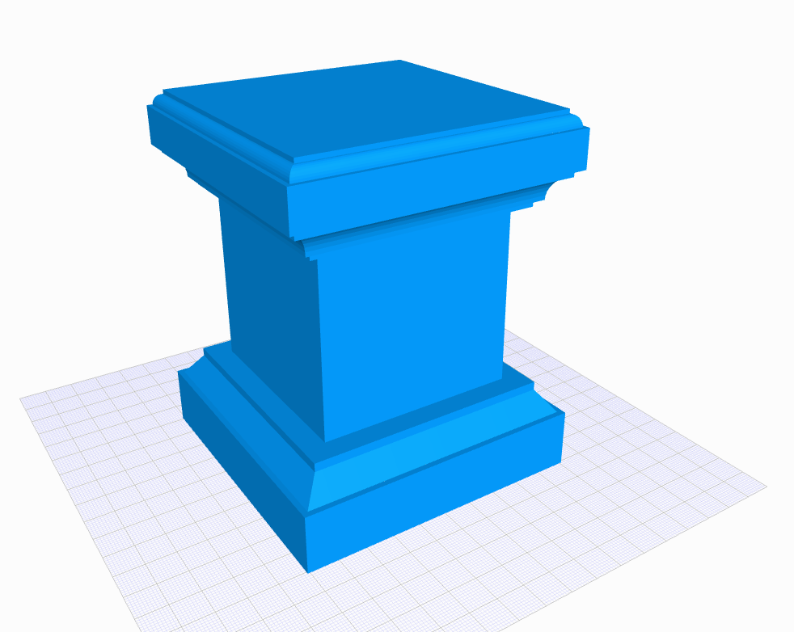

## Overview

### Online viewer

[sw-jscad-viewer.netlify.app](https://sw-jscad-viewer.netlify.app/)  

A heavily customized version of the JSCAD UI ([https://github.com/hrgdavor/jscadui](https://github.com/hrgdavor/jscadui))

### API Docs  

[salvador-workshop.github.io/swcad-js/](https://salvador-workshop.github.io/swcad-js/)  

### Repository

[github.com/salvador-workshop/swcad-js/](https://github.com/salvador-workshop/swcad-js/)  

### NPM package

[npmjs.com/package/swcad-js](https://www.npmjs.com/package/swcad-js)  

## SWCAD-JS API

SWCAD-JS functions and utilities.

---

 

### DATA

Mostly math constants and common dimensions/options.

### data.constants

Numeric constants and ratios.

### data.standards

Dimensions and options used throughout the SWCAD-JS system.

---

 

### CALCS

Math calculations and basic JSCAD operations.

### calcs.geometry

Geometric calculations in 2D/3D space.

#### angleOfTwoPtLine(startPt, endPt, mode)

Returns angle of a two-point line.

#### coordDiffBetweenPoints(startPt, endPt)

Calculates co-ordinate difference between two points.

#### distanceBetweenPoints(startPt, endPt)

Calculates distance between two co-ordinate points.

#### getSquarePtsInArea(x, y, distance, centrePoints)

Gets square points in area.

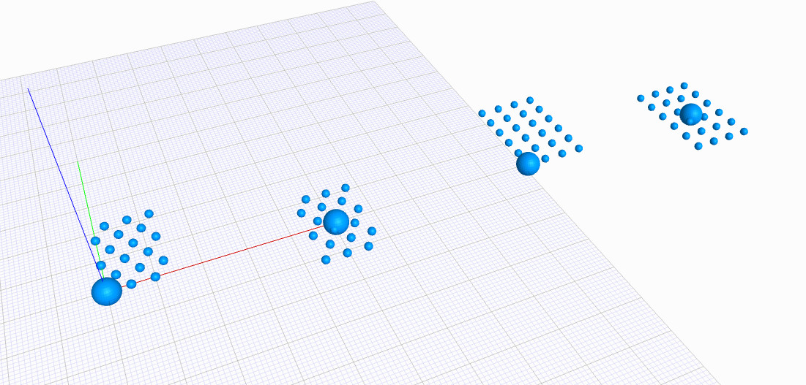

#### getTriangularPtsInArea(x, y, distance, centrePoints)

Gets triangular points in area.

#### midpointBetweenPoints(startPt, endPt)

Calculates midpoint between two co-ordinate points.

#### pointFromAngleAndDist(angleRad, dist)

Gets a point from a given angle and distance, starting from [0, 0].

---

### calcs.geometry.points

Calculations around sets of co-ordinate points in 2D/3D space.

#### ptCentroid(points, mode)

Finds the central point (avg.) between the given points.

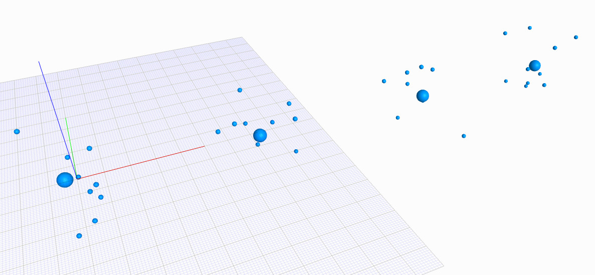

---

### calcs.geometry.regPoly

Calculations around regular (equiangular + equilateral) polygons.

#### apothemFromCircumradius(circumradius, numSides)

Calculates apothem from circumradius and # of sides.

#### apothemFromSideLength(sideLength, numSides)

Calculates apothem from side length and # of sides.

#### circumradiusFromApothem(apothem, numSides)

Calculates circumradius from apothem and # of sides.

#### circumradiusFromSideLength(sideLength, numSides)

Calculates circumradius from side length and # of sides.

#### interiorAngle(numSides)

Calculates interior angle from # of sides.

#### sideLengthFromApothem(apothem, numSides)

Calculates side length from apothem and # of sides.

#### sideLengthFromCircumRadius(circumradius, numSides)

Calculates side length from circumradius and # of sides.

---

### calcs.geometry.reinforcement

Calculations for reinforcement lines within a shape.

#### reinforcedRectangle(opts)

Calculates points and lines for a rectangule with internal reinforcements.

---

### calcs.math

Various math calculations.

#### arrayCartesianProduct(a, b)

Collection of all possible ordered pairs (a, b) such that the first element a belongs to set A and the second element b belongs to set B.

#### factorize(num)

Given an integer, calculates two integers that are factors for a containing rectangle around the input.

#### getRandomInt(min, max)

Gets a random integer between `min` and `max`. The maximum is exclusive and the minimum is inclusive.

#### inchesToMm(numInches)

Converts distance in inches to mm.

#### isEven(n)

Checks if a given integer is even.

#### isOdd(n)

Checks if a given integer is odd.

#### mmToInches(numMils)

Converts distance in mm to inches.

---

### calcs.position

Functions leveraging JSCAD to get position data or move 2D/3D geometries.

#### alignModes

Common alignment modes (for JSCAD's `align()` function).

#### measure(inputGeom)

Measures key info (boundingBox, dimensions).

#### ctr(inGeom, pt)

Centers the given geometry, relative to the given point (defaults to [0,0,0]).

#### ctrMax(inGeom, pt)

Centers the given geometry (maximum Z), relative to the given point (defaults to [0,0,0]).

#### ctrMin(inGeom, pt)

Centers the given geometry (minimum Z), relative to the given point (defaults to [0,0,0]).

#### findLongAxis(size)

Finds long axis of a co-ord set.

#### getGeomCoords(geom)

Gets 3D bounding coordinates of a given geometry.

---

### calcs.transform

Functions leveraging JSCAD to transform 2D/3D geometries.

#### bisect3d(opts, geom)

Cuts a given geometry in half.

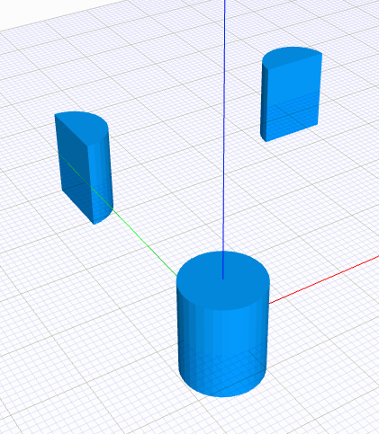

#### cutCircularSlice(opts, geom)

Cuts a slice of an object.

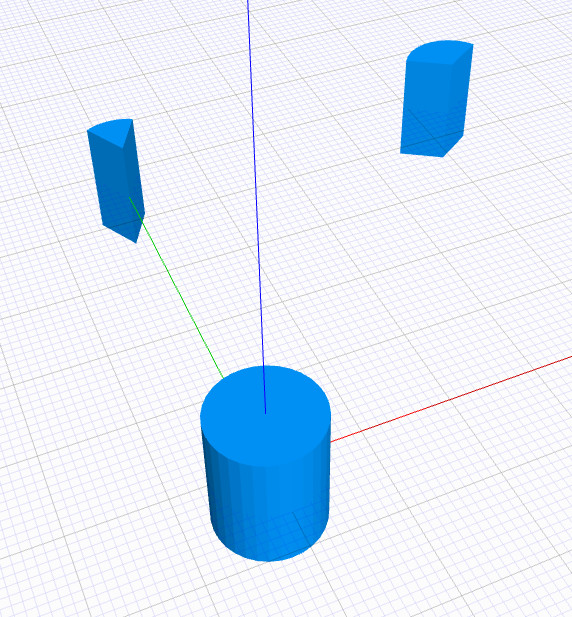

#### cloneQuadrant(inShape)

Clones one quadrant of the given 2D shape into all quadrants.

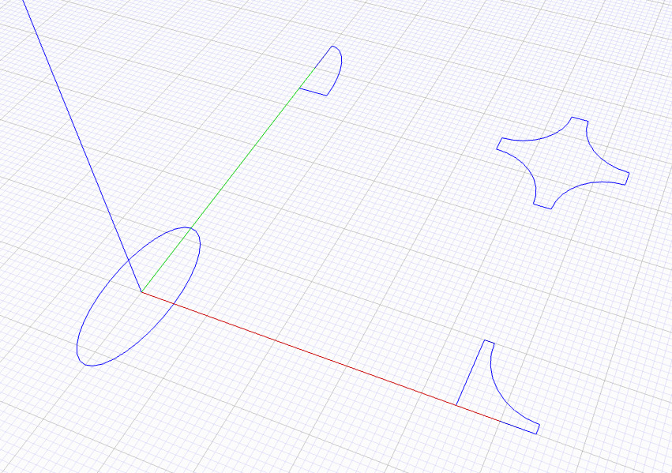

#### cutQuadrant(inShape)

Cuts one quadrant of the given 2D shape.

#### stack(opts, geoms)

Stacks geometries on top of each other, starting from the bottom.

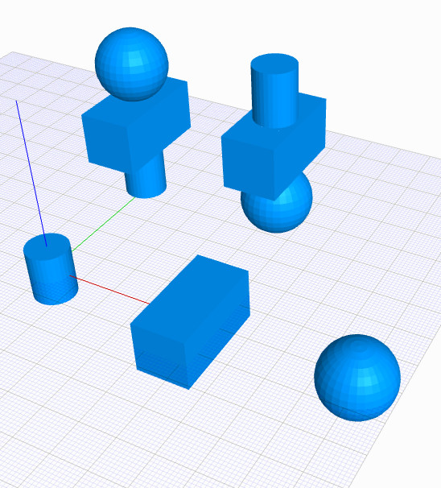

---

 

### PROFILES

Modelling functions that generate 2D geometries.

---

### profiles.beadsBits

Modelling functions that generate 2D beads (basic shapes mainly for additive `hull` functions) and bits (basic shapes for subtractive `hull` functions).

---

### profiles.beadsBits.corner

Modelling functions that generate 2D shapes which emulate woodworking router bits.

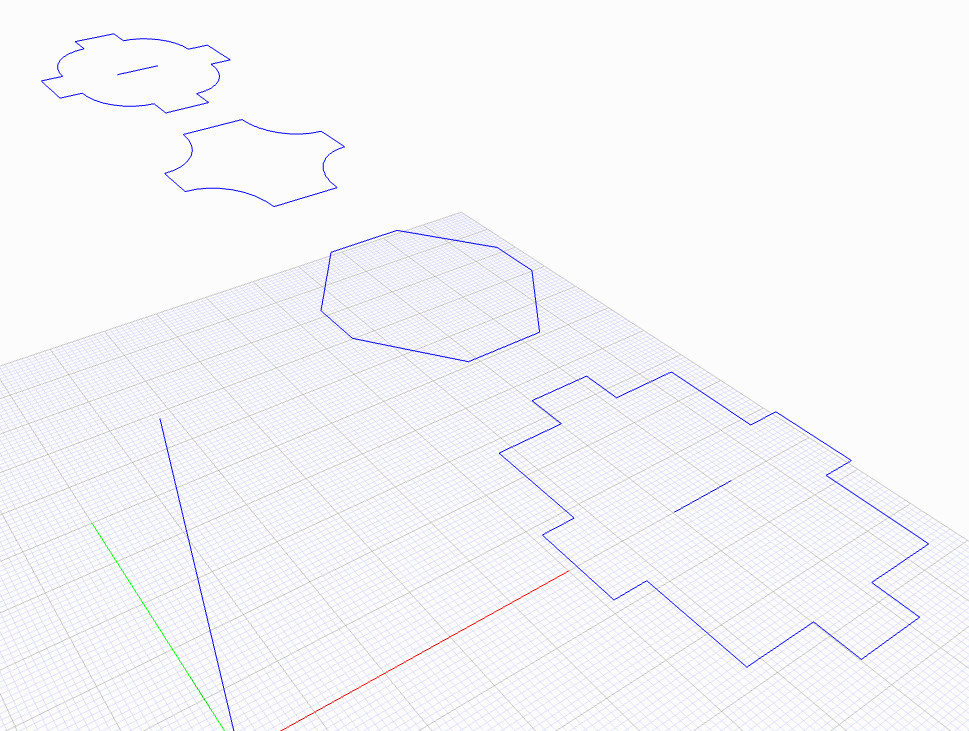

#### chamfer(opts)

Generates a 2D chamfer bit.

#### cove(opts)

Generates a 2D cove bit.

#### rabbet(opts)

Generates a 2D rabbet bit.

#### roundOver(opts)

Generates a 2D round-Over bit.

---

### profiles.connections

Modelling functions that generate connecting and interlocking 2D parts.

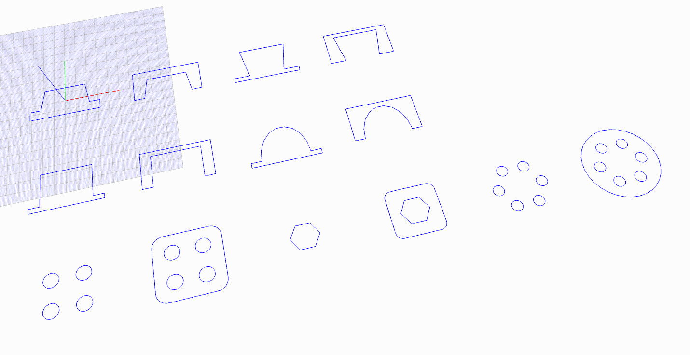

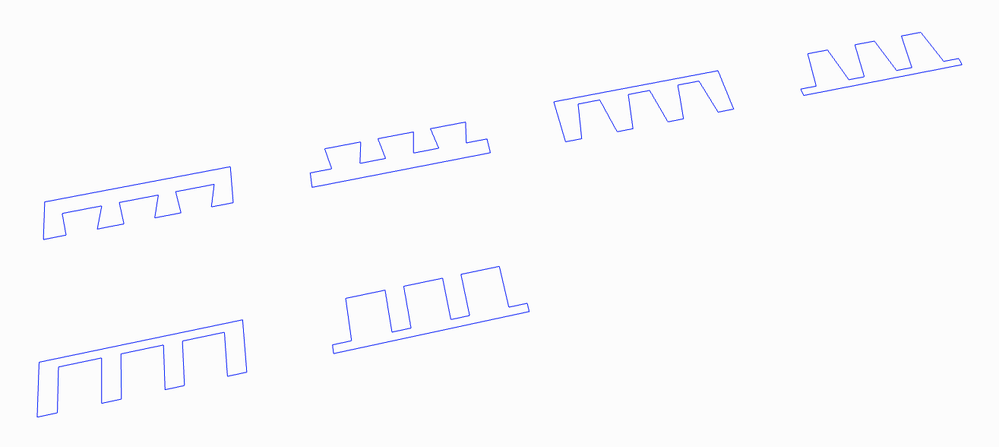

#### boltCircle(opts)

Generates bolt circle connectors.

#### dovetail(opts)

Generates dovetail connectors.

#### dovetailRow(opts)

Generates pieces connected by a row of dovetails.

#### ellipse(opts)

Generates ellipse connectors.

#### pegboard(opts)

Generates pegboard connectors.

#### polygon(opts)

Generates polygon connectors.

#### rightAngleTab(opts)

Generates right-angle tab connectors.

#### rightAngleTabRow(opts)

Generates pieces connected by a row of right-angle tabs.

#### tab(opts)

Generates tab connectors.

#### tabRow(opts)

Generates pieces connected by a row of tabs.

---

### profiles.connections.jointPanel

Modelling functions that generate connecting and interlocking 2D panels.

#### oneJointRectPanel(opts)

Generates a set of two interlocking panels, made by dividing a rectangle in half with the given options.

")

#### twoJointRectPanel(opts)

Generates a set of four interlocking panels, made by dividing a rectangle into quarters with the given options.

")

---

### profiles.mesh

Modelling functions that generate 2D perforated shapes.

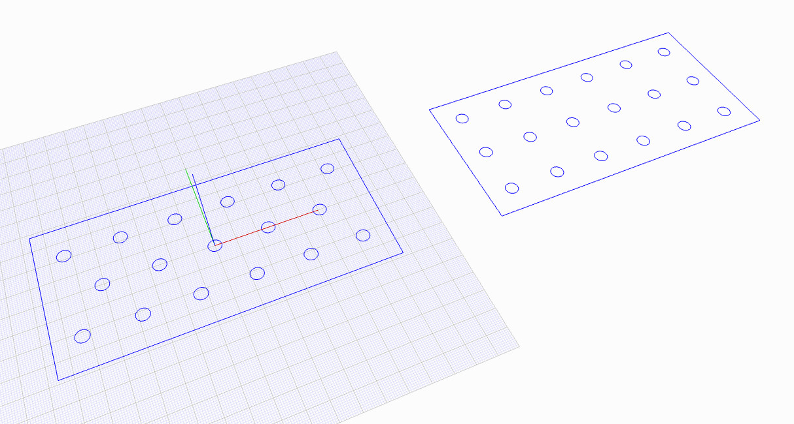

#### meshPanel(opts)

Generates a 2D mesh panel with the given options.

---

### profiles.reinforcements

Modelling functions that generate 2D shapes for reinforcements.

#### reinforcedRect(opts)

Generates a 2D reinforced rectangle with the given options for reinforcement styles.

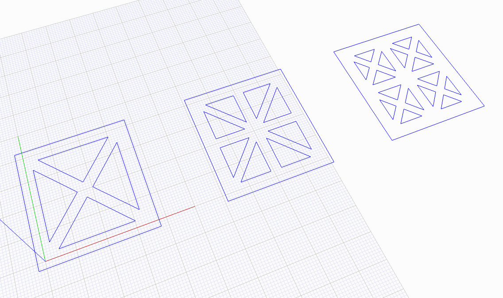

---

### profiles.reinforcements.boxCurve

Modelling functions that generate curved 2D reinforcements for right-angle corners.

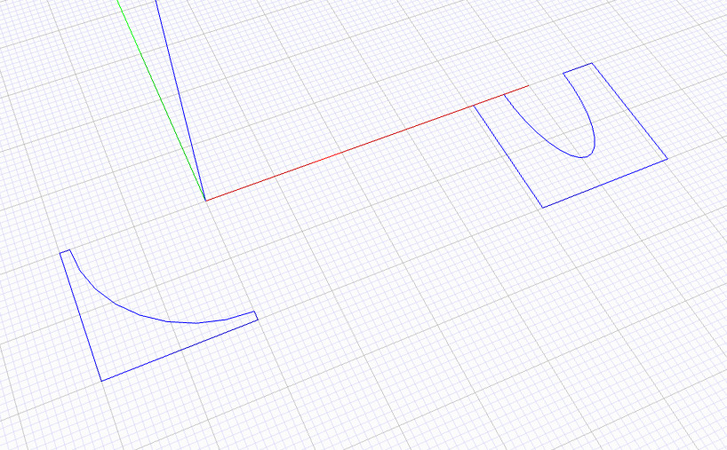

#### boxCurveHalf(opts)

Generates a curved 2D reinforcement covering three sides (two corners) of a rectangle.

#### boxCurveQuarter(opts)

Generates a curved 2D reinforcement covering two sides (one corner) of a rectangle.

---

### profiles.text

Modelling functions that generate 2D text.

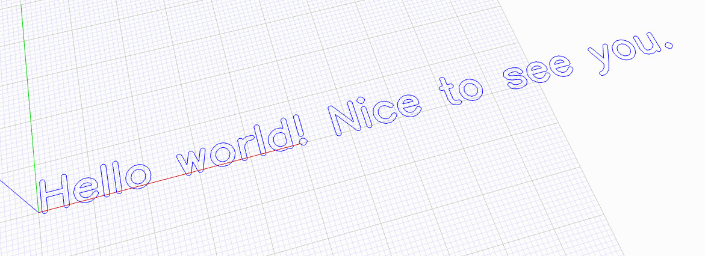

#### basicText(param0)

Generates a simple 2D line of text.

---

 

### COMPONENTS

Modelling functions that generate 3D geometries.

#### componentLine(opts)

Generates a line connecting several repetitions of the given component. Accepts various options for spacing and offsets.

---

### components.beadsBits

Modelling functions that generate 3D beads (basic shapes mainly for additive `hull` functions) and bits (basic shapes for subtractive `hull` functions).

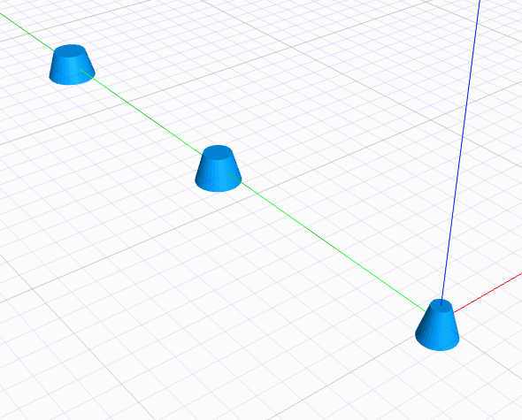

#### basic30DegBead(baseThickness, width)

Generates an elliptical cylinder bead, with a 30-degree slope.

#### basic45DegBead(baseThickness, width)

Generates an elliptical cylinder bead, with a 45-degree slope.

#### interface30DegProfileBeads(baseThickness, smWidth, mdWidth, lgWidth)

Generates a set of elliptical cylinder beads for interface connections.

---

### components.beadsBits.corner

Modelling functions that generate 3D geometries which emulate woodworking router bits.

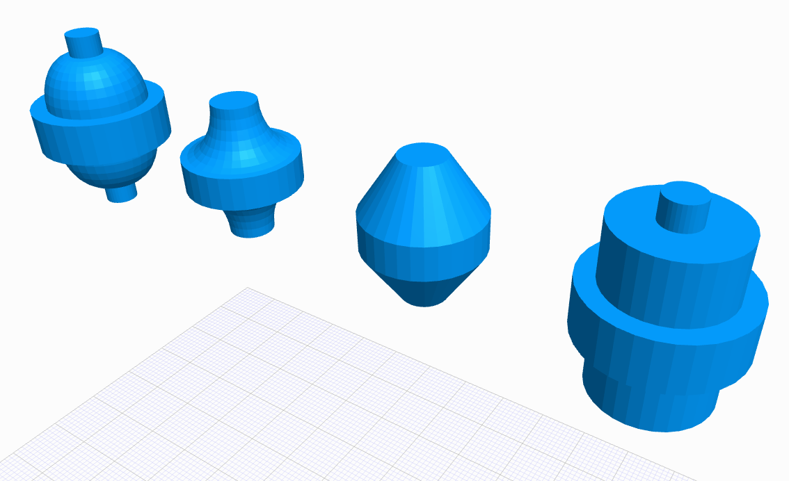

#### chamfer(opts)

Generates a 3D chamfer bit.

#### cove(opts)

Generates a 3D cove bit.

#### rabbet(opts)

Generates a 3D rabbet bit.

#### roundOver(opts)

Generates a 3D round-over bit.

---

### components.fittings

Modelling functions that generate 3D fittings that integrate with round/rectangular profiles (dowels, dimensional lumber, etc).

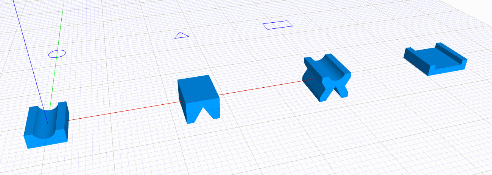

#### doubleRoundFitting(opts)

Generates a fitting that accomodates 2 round dowels, plus space for 2 side dowels.

#### invRoundFittingCutProfile(opts)

Generates a 2D cutaway profile for inverted round fittings.

#### inverseRoundFitting(opts)

Generates a fitting for dowels, inverted for 3D-printing from the bottom (triangular groove).

#### rectFittingCutProfile(opts)

Generates a 2D cutaway profile for square/rectangular fittings.

#### rectangularFitting(opts)

Generates a fitting for square/rectangular dowels.

#### roundFitting(opts)

Generates a fitting for dowels (round groove).

#### roundFittingCutProfile(opts)

Generates a 2D cutaway profile for round fittings.

---

### components.mesh

Modelling functions that generate perforated 3D shapes.

#### meshPanel(opts)

Generates a flat 3D mesh panel with the given options.

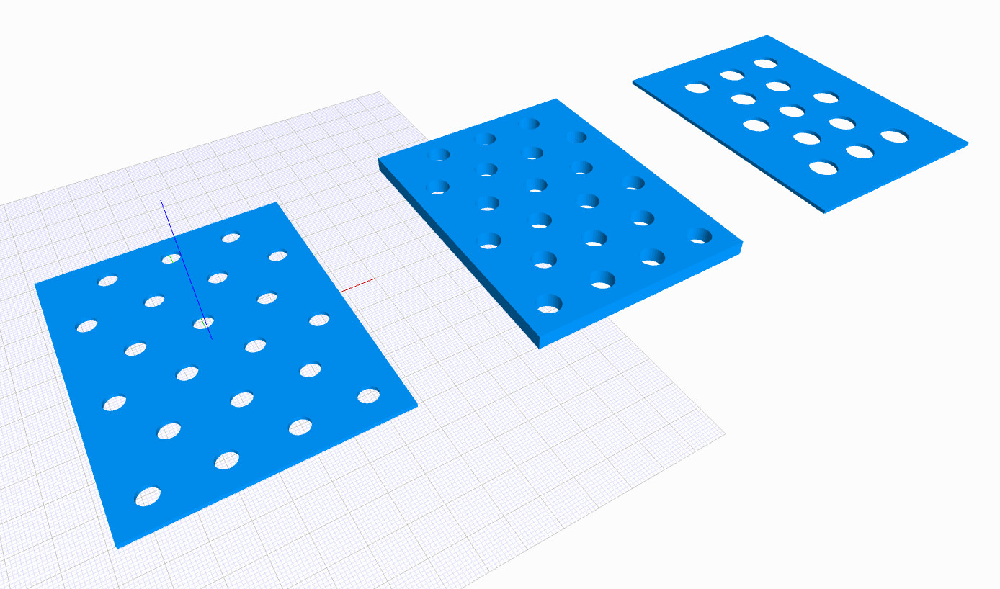

---

### components.reinforcements

Modelling functions that generate 3D reinforcements.

#### reinforcedJoist(opts)

Generates an open web joist with the given options for reinforcement styles.

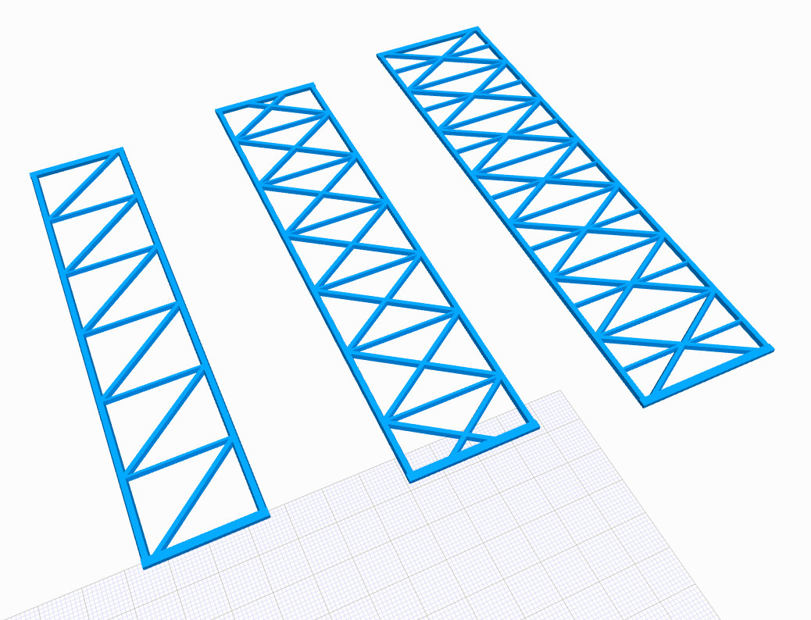

#### reinforcedRectPanel(opts)

Generates a reinforced 3D rectangular panel with the given options for reinforcement styles.

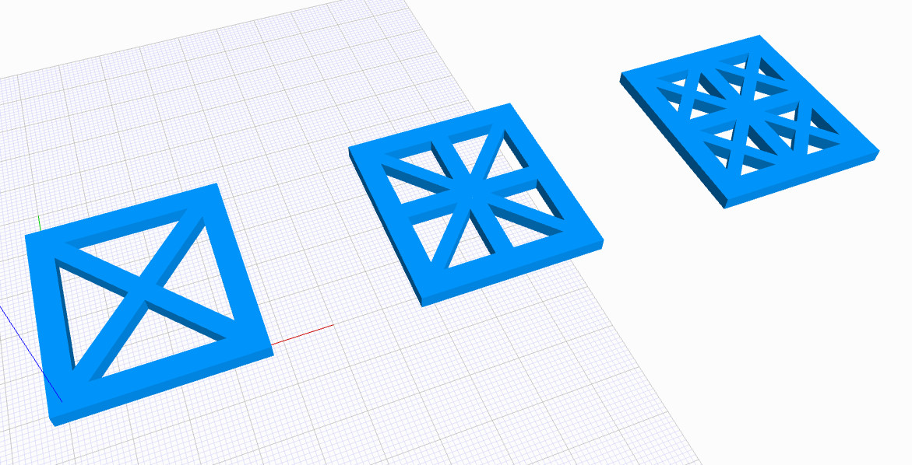

---

### components.reinforcements.boxSupport

Modelling functions that generate curved 3D reinforcements for right-angle corners.

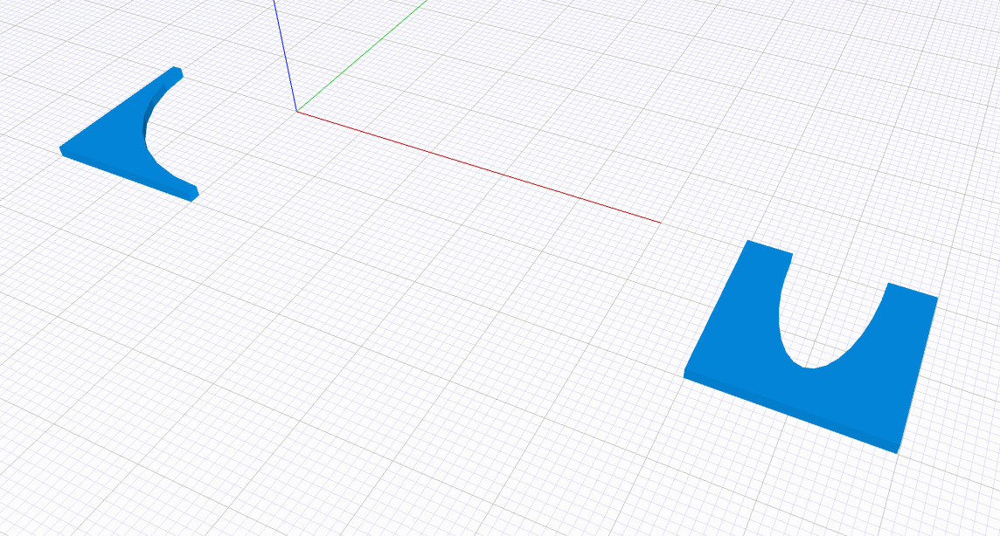

#### boxSupportHalf(opts)

Generates a curved 3D reinforcement covering three sides (two corners) of a rectangle.

#### boxSupportQuarter(opts)

Generates a curved 3D reinforcement covering two sides (one corner) of a rectangle.

---

### components.routedShapes

Modelling functions that generate 3D geometries which have been "routed" with bits from `components.beadsBits.corner`.

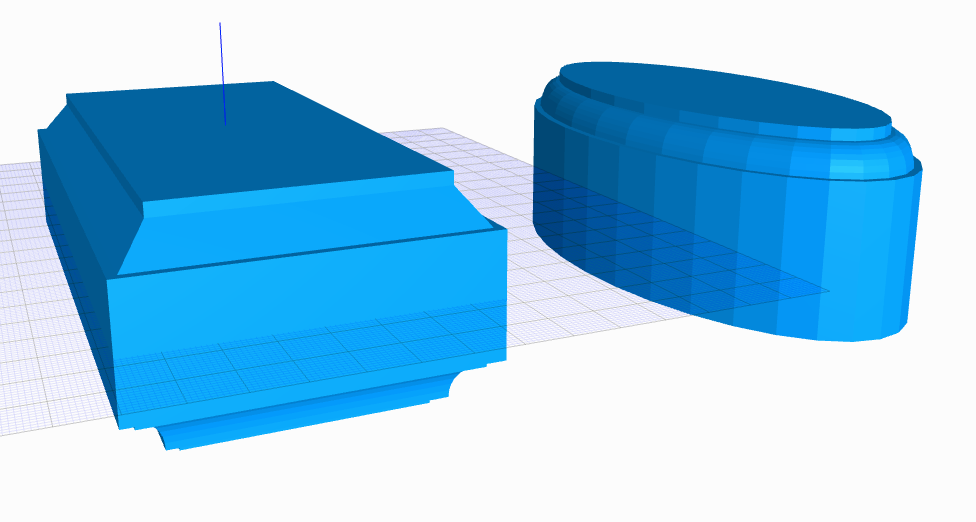

#### routedCuboid(opts)

Generates a routed cuboid with the given options for top and bottom edges.

#### routedCylinderElliptic(opts)

Generates a routed elliptical cylinder with the given options for top and bottom edges.

---

### components.text

Modelling functions that generate 3D text.

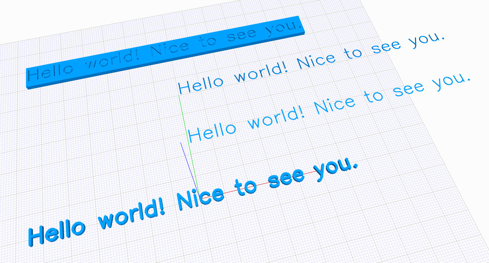

#### engravedText(opts)

Generates a 3D line of text, with engraved profile.

#### flatText(param0)

Generates a simple 3D line of text.

#### textPanel(opts)

Generates a rectangular panel with engraved text.
