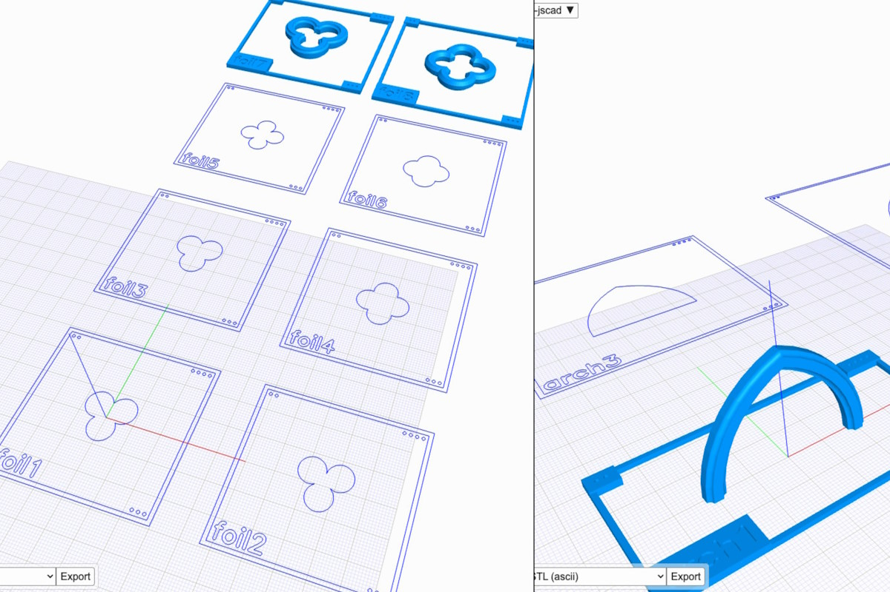
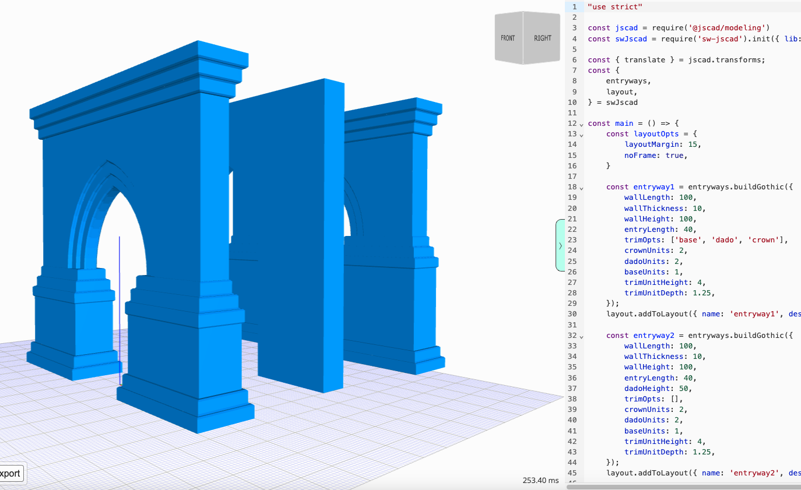

# swcad-js

Salvador Workshop's CAD coding tools (in JavaScript)

---

## Overview

### Online viewer

[sw-jscad-viewer.netlify.app](https://sw-jscad-viewer.netlify.app/)  

A heavily customized version of the JSCAD UI ([https://github.com/hrgdavor/jscadui](https://github.com/hrgdavor/jscadui))

### API Docs  

[salvador-workshop.github.io/swcad-js/](https://salvador-workshop.github.io/swcad-js/)  

### Repository

[github.com/salvador-workshop/swcad-js/](https://github.com/salvador-workshop/swcad-js/)  

### NPM package

[npmjs.com/package/swcad-js](https://www.npmjs.com/package/swcad-js)  

## SWCAD-JS API

...

---

 

### DATA

...

### data.constants

Numeric constants and ratios.

### data.standards

Dimensions and options used throughout the SWCAD-JS system.

---

 

### CALCS

Math calculations and basic JSCAD operations

### calcs.geometry

...

#### angleOfTwoPtLine(startPt, endPt, mode)

Returns angle of a two-point line.

#### coordDiffBetweenPoints(startPt, endPt)

Calculates co-ordinate difference between two points

#### distanceBetweenPoints(startPt, endPt)

Calculates distance between two co-ordinate points

#### getSquarePtsInArea(x, y, distance, centrePoints)

Gets square points in area

#### getTriangularPtsInArea(x, y, distance, centrePoints)

Gets triangular points in area

#### midpointBetweenPoints(startPt, endPt)

Calculates midpoint between two co-ordinate points

#### pointFromAngleAndDist(angleRad, dist)

Gets a point from a given angle and distance, starting from [0, 0]

---

### calcs.geometry.points

...

#### ptCentroid(points, mode)

Finds the central point (avg.) between the given points

---

### calcs.geometry.regPoly

...

#### apothemFromCircumradius(circumradius, numSides)

Calculates apothem from circumradius and # of sides

#### apothemFromSideLength(sideLength, numSides)

Calculates apothem from side length and # of sides

#### circumradiusFromApothem(apothem, numSides)

Calculates circumradius from apothem and # of sides

#### circumradiusFromSideLength(sideLength, numSides)

Calculates circumradius from side length and # of sides

#### interiorAngle(numSides)

Calculates interior angle from # of sides

#### sideLengthFromApothem(apothem, numSides)

Calculates side length from apothem and # of sides

#### sideLengthFromCircumRadius(circumradius, numSides)

Calculates side length from circumradius and # of sides

### calcs.geometry.reinforcement

#### reinforcedRectangle(opts)

Calculates points for a rectangular frame with internal reinforcements

---

### calcs.math

#### arrayCartesianProduct(a, b)

Collection of all possible ordered pairs (a, b) such that the first element a belongs to set A and the second element b belongs to set B.

#### factorize(num)

Given an integer, calculates two integers that are factors for a containing rectangle around the input.

#### getRandomInt(min, max)

Gets a random integer between `min` and `max`. The maximum is exclusive and the minimum is inclusive

#### inchesToMm(numInches)

Converts distance in inches to mm

#### isEven(n)

Checks if a given integer is even

#### isOdd(n)

Checks if a given integer is odd

#### mmToInches(numMils)

Converts distance in mm to inches

---

### calcs.position

...

#### alignModes

...

#### measure()

Measures key info, and presents it in a readable manner, like `{ size: { x: 99, y: 99, z: 99 }, min: { ... }, max: { ... } }`

#### ctr(inGeom, pt)

...

#### ctrMax(inGeom, pt)

...

#### ctrMin(inGeom, pt)

...

#### findLongAxis(size)

Finds long axis of a coord set

#### getGeomCoords(geom)

Gets 3D bounding coordinates of a given geometry

---

### calcs.transform

#### bisect3d(opts, geom)

Cuts a given geometry in half.

#### cutCircularSlice(opts, geom)

Cuts a slice of an object

#### cloneQuadrant(inShape)

Clones one quadrant of the given 2D shape into all quadrants.

#### cutQuadrant(inShape)

Cuts one quadrant of the given 2D shape

#### stack(opts, geoms)

Stacks geometries on top of each other, starting from the bottom

---

 

### PROFILES

...

### profiles.beadsBits.corner

...

#### chamfer(opts)

Chamfer bit

#### cove(opts)

Cove bit

#### rabbet(opts)

Rabbet bit

#### roundOver(opts)

Round-Over bit

---

### profiles.connections

...

#### boltCircle(opts)

Generate bolt circle connectors

#### dovetail(opts)

Generate dovetail connectors

#### dovetailRow(opts)

Generate dovetail row connectors

#### ellipse(opts)

Generate ellipse connectors

#### pegboard(opts)

Generate pegboard connectors

#### polygon(opts)

Generate polygon connectors

#### rightAngleTab(opts)

Generate right-angle tab connectors

#### rightAngleTabRow(opts)

Generate right-angle tab row connectors

#### tab(opts)

Generate tab connectors

#### tabRow(opts)

Generate tab row connectors

---

### profiles.connections.jointPanel

...

#### oneJointRectPanel(opts)

...

#### twoJointRectPanel(opts)

...

---

### profiles.mesh

...

#### meshPanel(opts)

...

---

### profiles.reinforcements

...

#### reinforcedRect(opts)

Reinforced rectangle

---

### profiles.reinforcements.boxCurve

...

#### boxCurveHalf(opts)

...

#### boxCurveQuarter(opts)

...

---

### profiles.text

...

#### basicText(param0)

Creates a simple 2D line of text

---

 

### COMPONENTS

...

#### componentLine(opts)

Component Line

---

### components.beadsBits

...

#### basic30DegBead(baseThickness, width)

Standard 30-degree bead profile

#### basic45DegBead(baseThickness, width)

Standard 45-degree bead profile

#### interface30DegProfileBeads(baseThickness, smWidth, mdWidth, lgWidth)

Standard bead profiles for interface connections

---

### components.beadsBits.corner

...

#### chamfer(opts)

Chamfer bit

#### cove(opts)

Cove bit

#### rabbet(opts)

Rabbet bit

#### roundOver(opts)

Round-Over bit

---

### components.fittings

...

#### doubleRoundFitting(opts)

Fitting that accomodates 2 primary dowels, plus space for 2 side dowels

#### invRoundFittingCutProfile(opts)

...

#### inverseRoundFitting(opts)

Simple dowel fitting, inverted for 3D-printing from the bottom (triangular groove)

#### rectFittingCutProfile(opts)

...

#### rectangularFitting(opts)

...

#### roundFitting(opts)

Simple dowel fitting (round groove)

#### roundFittingCutProfile(opts)

...

---

### components.mesh

...

#### meshPanel(opts)

Builds a flat mesh panel model.

---

### components.reinforcements

...

#### reinforcedJoist(opts)

Component for generating an open web joist, with various options for dimensions and reinforcement levels.

#### reinforcedRectPanel(opts)

...

---

### components.routedShapes

...

#### routedCuboid(opts)

Routed cuboid

#### routedCylinderElliptic(opts)

Routed elliptical cylinder

---

### components.text

...

#### engravedText(opts)

Creates a 3D line of text, with engraved profile

#### flatText(param0)

Creates a simple 3D line of text

#### textPanel(opts)

Creates a rectangular panel with engraved text
